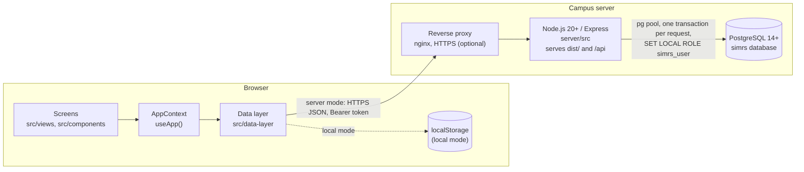
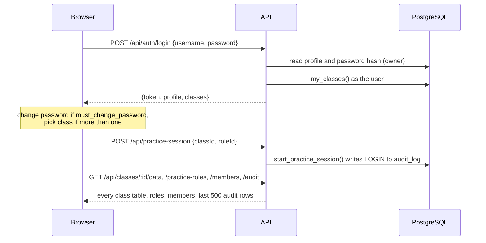
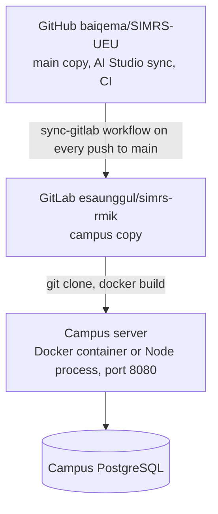

# Architecture

## 1. Overview

SIMRS Esa Unggul is a single-page React app with an optional backend. The same screens run in two modes:

- **Local mode**: no backend. Each browser keeps its own data in `localStorage`. Used in Google AI Studio and for quick demos.
- **Server mode**: one Node.js process serves the built app and a JSON API under `/api`, backed by PostgreSQL. Used on the campus server.

The build-time variable `VITE_API_URL` picks the mode: empty means local, `/api` means server (`src/data-layer/config.ts`).

## 2. Components

| Component | Location | Responsibility |
| --- | --- | --- |
| Screens | `src/views/`, `src/components/` | 24 views, forms, print layouts. Built and maintained by Ema in AI Studio. They reach data only through `useApp()`. |
| App context | `src/context/AppContext.tsx` | Holds every data list, the signed-in user and role, navigation, and the domain actions (register patient, save coding, process payment, ...). Writes an audit entry for each action in local mode. Decides page access (`hasPageAccess` in `App.tsx`) and edit rights (`canEditPage`). |
| Reference data | `src/data/` | Seed data (`mockData.ts`, `masterDataInit.ts`), ICD-10/ICD-9-CM database, SIRS RL reference data, KMK 1423 metadata, INA-CBG guidance, Indonesian regions, demo accounts. |
| Data layer | `src/data-layer/` | `useSlice` stores one list either in `localStorage` or on the server; `diff` computes upserts and deletes; `syncEngine` pushes and loads tables; `useServerSession` signs in, starts the practice session, polls for others' changes; `session` and `serverQueries` call the API. |
| API client | `src/lib/apiClient.ts` | `fetch` wrapper that adds the token and turns error bodies into exceptions. |
| API server | `server/src/` | Express app (`app.ts`), login and accounts, per-request transactions (`db.ts`), migrations (`migrate.ts`), admin CLI (`cli.ts`). |
| Database | `db/migrations/`, `db/seed.sql` | Schema, row-level security, audit triggers, class functions; template class data. |
| Build and run | `Dockerfile`, `docker-compose.yml`, `.github/workflows/ci.yml` | Two-stage Node 22 image; compose with PostgreSQL 16; CI runs type check, unit tests, integration tests on PostgreSQL and both builds. |

## 3. Data flow in server mode

### 3.1 Sign-in and entering a class

### 3.2 Saving

1. A screen calls a context action, which updates a list in React state.
2. `useSlice` compares the new list with the last saved one and sends only the changed rows: `POST /api/classes/:classId/data/:table` with `{upserts, deletes}` (in chunks of 500).
3. The API opens a transaction, sets `simrs.user_id` and switches to the `simrs_user` role. Row-level security decides whether the rows may be written; triggers stamp `created_by`/`updated_by` and write the audit log.
4. If the database refuses, the browser shows an error toast and reloads that table from the server.

### 3.3 Seeing other users' changes

Every write lands in `audit_log`. While the tab is visible the browser asks every 5 seconds for audit rows newer than the last one it saw (`GET /api/classes/:id/audit?after=<id>`). Each row written by another user carries the table, the record id and the new record, so the browser applies it directly (upsert or delete) without reloading the table. The user's own rows are skipped because they are already on screen. A `RESET` entry reloads everything. Returning to the tab also reloads everything.

There are no websockets; polling keeps the server stateless and works through any proxy.

## 4. Security model

| Layer | Mechanism |
| --- | --- |
| Passwords | scrypt (N=16384, r=8, p=1, 16-byte salt) from Node's standard library; minimum 8 characters; constant-time compare; a dummy hash for unknown users |
| Tokens | JWT HS256 signed with `JWT_SECRET` (at least 32 characters), subject = user id, default lifetime 12 h. No refresh tokens; changing the secret signs everyone out. |
| Brute force | In-memory limiter: 10 failures per username, 200 per IP, per 15 minutes |
| Authorisation | The API runs each request as the user: `set_config('simrs.user_id', …)` and `SET LOCAL ROLE simrs_user`. PostgreSQL row-level security and `security definer` functions enforce class membership, practice role and account type (see [roles §5](02-users-and-roles.md#5-what-the-database-enforces)). Only login, account creation and roster import run with the owner's rights. |
| Input checks | Table names checked against a fixed list; UUIDs validated; at most 2 000 rows per save; 10 MB body limit; each row must be an object with a text `id` equal to its key |
| Audit | Triggers on every class table and on `practice_roles`; `audit_log` rejects update, delete and truncate |
| Transport | HTTPS is terminated by the campus reverse proxy; `TRUST_PROXY` tells Express which proxy may set the client IP |
| Secrets | `.env` only; never committed. Demo passwords are refused for the real admin. |

All data is simulated, so the system holds no personal data, but the same controls are applied as if it did, because they are part of what students are taught.

## 5. Multi-class design

- Each class is a full hospital: every clinical and master data table has `class_id` in its primary key.
- One special class, the **template** (`is_template = true`, id `00000000-0000-0000-0000-000000000001`), holds the starting data from `db/seed.sql`. It cannot be used or reset.
- `create_class` and `reset_class` copy every table from the template, replacing the placeholders `__TODAY__` and `__TODAYCOMPACT__` with the current date so "today's" registrations are current. Copying does not write audit rows; a single `CREATE` or `RESET` event is logged instead.
- Practice roles are global, not per class.

## 6. Running modes compared

| | Local mode | Server mode |
| --- | --- | --- |
| Build | `npm run build` | `VITE_API_URL=/api npm run build && npm run server:build` |
| Data | `localStorage`, one browser | PostgreSQL, shared per class |
| Accounts | Prototype list in `mockData.ts`, passwords in the browser | `auth.users` / `profiles` with hashed passwords |
| Access control | Screens only | Screens plus row-level security |
| Audit | Kept in the browser | Append-only table |
| Farmasi, Lab, Radiologi | Sample data | Sample data (not stored) |

## 7. Deployment

- Install, configuration, backups and updates are in [campus-deployment.md](../operations/campus-deployment.md). How GitLab is kept in step is in [gitlab-sync.md](../operations/gitlab-sync.md).
- Migrations run in name order, each in its own transaction, recorded in `simrs_meta.schema_migrations`; `MIGRATE_ON_START=true` applies them at startup. `db/seed.sql` only rewrites the template class, so it is safe to reload.
- Sizing for a class of about 50 students: 1 vCPU and 1 GB RAM for the app.
- Health check: `GET /api/health`.

## 8. Technology

| Area | Choice |
| --- | --- |
| Front end | React 19, TypeScript 5.8, Vite 6, Tailwind CSS 4, Chart.js, lucide-react, SweetAlert2, motion |
| Back end | Node.js 20+ (image uses 22), Express 4, `pg`, `jsonwebtoken`, bundled with esbuild |
| Database | PostgreSQL 14+ with `pgcrypto` (CI and compose use 16) |
| Tests | Vitest: unit tests without a database, integration tests against a throwaway PostgreSQL |

## 9. Design decisions

| Decision | Reason |
| --- | --- |
| Own API on plain PostgreSQL instead of Supabase (Oct 2026) | The campus has its own PostgreSQL server and no cloud services may be used in production. |
| Records stored as JSON (`data jsonb`) in one table per screen list | The screens are edited in AI Studio and change shape often; JSON lets them change without a migration, while the database still enforces class, role and audit rules on the row. |
| Row-level security in the database rather than checks in the API | One place for the rules; the API cannot forget a check; students can be shown the rules as teaching material. |
| Polling instead of websockets | Simple, stateless, works behind any campus proxy; 5 s is fast enough for a classroom. |
| Screens talk only to `useApp()` | AI Studio can rewrite screens freely without breaking persistence. |
