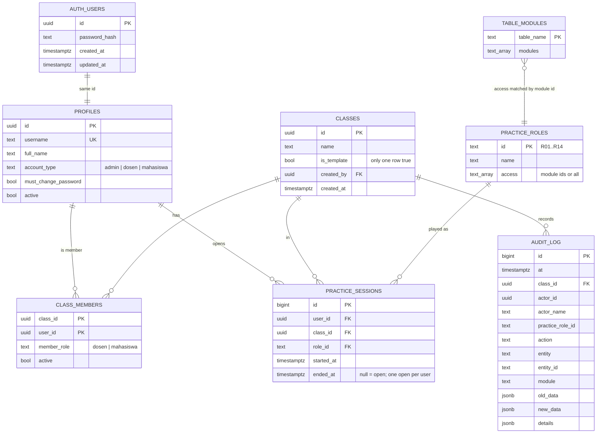
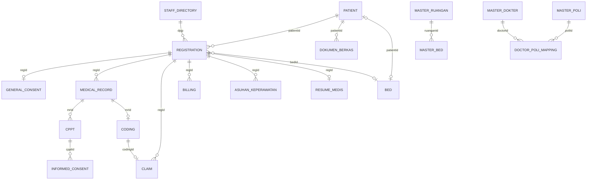

# Data model

The database has two kinds of tables:

- **Platform tables** with ordinary columns: accounts, classes, membership, practice roles and sessions, audit log.
- **Class data tables**, one per list in the app (patients, registrations, ...). Each row belongs to one class and stores the app's record as JSON in `data`. The JSON shapes are the TypeScript interfaces in `src/types.ts`, summarised in §4.

Source of truth: `db/migrations/*.sql` (schema) and `src/types.ts` (record shapes).

## 1. Schemas

| Schema | Contents | Who can reach it |
| --- | --- | --- |
| `auth` | `users` (password hashes), `uid()` | Owner only; `simrs_user` may call `auth.uid()` |
| `public` | Platform tables, class data tables, functions used by the API | `simrs_user`, filtered by row-level security |
| `private` | Helper functions (template copy, audit trigger, table lists) | Owner only |
| `simrs_meta` | `schema_migrations` | Owner only |

## 2. Entity relationship diagram

### 2.1 Platform

### 2.2 Class data (logical relations inside `data`)

The database does not enforce these links; they are ids inside the JSON, kept consistent by the app.

## 3. Class data tables

All 19 tables have the same columns:

| Column | Type | Notes |
| --- | --- | --- |
| `class_id` | uuid | FK `classes.id`, cascade delete. Part of the primary key. |
| `id` | text (1–200 chars) | The record's own `id`. Part of the primary key. |
| `data` | jsonb | The record. Must be an object whose `id` equals the `id` column. |
| `seq` | bigint identity | Insert order, used to keep the app's list order |
| `created_by`, `updated_by` | uuid | Set by trigger from the signed-in user |
| `created_at`, `updated_at` | timestamptz | Set by trigger |

Index on `(class_id, created_at desc, seq)`. Rows are returned newest first.

| Table | App list (`src/data-layer/slices.ts`) | Record type | Write rule |
| --- | --- | --- | --- |
| `patients` | `patients` | `Patient` | Role module: pendaftaran |
| `registrations` | `registrations` | `Registration` | pendaftaran, bedmanagement |
| `beds` | `beds` | `Bed` | pendaftaran, bedmanagement |
| `general_consents` | `generalConsents` | `GeneralConsent` | pendaftaran, generalconsent |
| `medical_records` | `medicalRecords` | `MedicalRecord` | rekammedis, pemeriksaan |
| `cppt` | `cppt` | `CPPT` | rekammedis, cppt |
| `informed_consents` | `informedConsents` | `InformedConsent` | informedconsent |
| `asuhan_keperawatan` | `asuhanKeperawatan` | `AsuhanKeperawatan` | keperawatan |
| `resume_medis` | `resumeMedisList` | `ResumeMedis` | resumemedis |
| `coding` | `coding` | `Coding` | coding, rekammedis, pemeriksaan |
| `claims` | `claims` | `Claim` | klaim |
| `billing` | `billing` | `Billing` | rekammedis, pemeriksaan, billing, pembayaran |
| `dokumen_berkas` | `dokumenBerkas` | `DokumenBerkas` | pendaftaran, rekammedis, cppt, keperawatan, resumemedis, laboratorium, radiologi, coding |
| `staff_directory` | `staff` | `User` (hospital staff list, no passwords used) | manajemenuser |
| `master_ruangan` | `masterRuangan` | `MasterRuangan` | Admin only |
| `master_bed` | `masterBed` | `MasterBed` | Admin only |
| `master_dokter` | `masterDokter` | `MasterDokter` | Admin only |
| `master_poli` | `masterPoli` | `MasterPoli` | Admin only |
| `doctor_poli_mappings` | `doctorPoliMappings` | `DoctorPoliMapping` | Admin only |

Admins and the class's dosen may write every clinical table. Everyone in the class may read every table.

Not stored: pharmacy, laboratory and radiology records (`PharmacyRecord`, `LabRecord`, `RadiologyRecord`) are sample data held in memory (PRD Q1). Practice classes (`SimClass`) and roles in local mode are kept in `localStorage`.

## 4. Record shapes (JSON in `data`)

Main fields only; see `src/types.ts` for every optional field.

### Patient
`id`, `noRM`, `nik`, `name`, `dob`, `gender`, `address` with `country`, `province`, `regency`, `district`, `subDistrict`, `addressStreet`, `phone`, `bloodType`, `allergy`, `insuranceType` (`BPJS` | `Umum` | `Asuransi`), `noBPJS`, `bpjsStatus`, `bpjsClass`, `guarantor {name, phone, relation, address…}`, newborn fields `motherNoRM`, `motherName`, `birthWeight`, `birthLength`, `headCircumference`, `apgarScore`, `deliveryMethod`.

### Registration (visit)
`id`, `patientId`, `date`, `registrationTime`, `type` (`Rawat Jalan` | `Rawat Inap` | `IGD` | `Bayi Baru Lahir`), `poli`, `dpjp`, `status` (`Dirawat` | `Selesai` | `Dirujuk` | `Batal` | `Siap Diperiksa` | `Selesai Diperiksa`), `examinationStatus`, `sepNo`, `room`, `bedId`, `naikKelas`, `triageLevel`, `reasonForVisit`, `gcs`, `potensiFragmentasi`, `fragmentasiReason`, `rujukanDate`, `durasiHari`, `batasWaktuTerlampaui`, `overrideBatasWaktu {approved, approvedBy, approvedAt, reason}`.

### GeneralConsent
`id`, `regId`, `date`, `status` (`Signed` | `Pending`), signer and witness names and signature images, `signerRelation`, `pelepasanInformasiKhusus[]`, `catatanKhusus`.

### MedicalRecord
`id`, `regId`, `noRM`, `anamnesis`, `physicalExam`, `diagnosis`, `plan`, `nurseNotes`, `diagnosisStatus` (`Verified` | `Draft` | `Pending`), `doctorId`, `doctorSignature`, `nurseId`, `nurseSignature`, `date`.

### CPPT
`id`, `mrId`, `regId`, `date`, `time`, `subjective`, `objective`, `assessment`, `plan`, `formatType` (`SOAP` | `SBAR` | `ADIME`), `profession`, `staffName`, `unit`, `verified`, `vitalSigns {systolic, diastolic, heartRate, respRate, temp, spo2}`, `instructionPPA`, `medicines[] {drugName, qty, signa}`, `implementation`, `criticalValue`, `isDeleted`.

### InformedConsent
`id`, `cpptId`, `action`, `risk`, `complication`, `doctorId`, `date`, `status` (`Approved` | `Pending`), `informedConsentType` (`Persetujuan` | `Penolakan`), `diagnosisInfo`, `tataCaraTindakan`, `tujuanTindakan`, `prognosis`, `alternatifRisiko`, signatures of patient, doctor and witness.

### AsuhanKeperawatan
`id`, `regId`, `patientId`, `nurseId`, `nurseName`, `date`, `time`, `status` (`Draft` | `Final`), `keluhanUtama`, `riwayatPenyakit`, `alergi`, vital signs, `diagnosaSDKI[]`, `intervensiSIKI[]`, `luaranSLKI`, `implementasi`, `evaluasiSOAP {s, o, a, p}`.

### ResumeMedis
`id`, `regId`, `noRM`, `patientId`, `doctorId`, `admissionDate`, `dischargeDate`, `lengthOfStay`, `dischargeType`, `dischargeCondition`, `chiefComplaint`, `historyOfPresentIllness`, vital signs at admission and discharge, lab, radiology and other summaries, `admissionDiagnosis`, `primaryDiagnosisForm`, `primaryDiagnosisVerified`, `isDiagnosisMatched`, `secondaryDiagnoses[]`, `procedures[]`, `therapyDuringHospitalization[]`, `homeMedications[]`, `dischargeInstructions`, `followUpPlan`, `status` (`Belum Lengkap` | `Menunggu Verifikasi` | `Siap Difinalisasi` | `Final`), `missingFields[]`, `resolutionTargetHours` (24 or 48), `deadlineTimestamp`, `finalizedAt`, `finalizedBy`.

### Coding
`id`, `mrId`, `regId`, `icd10[]`, `icd10Desc[]`, `icd9cm[]`, `icd9cmDesc[]`, `coderId`, `date`, `status` (`Draft` | `Locked`), `note`. Older records may hold a single string instead of an array.

### Claim
`id`, `regId`, `codingId`, `sepNo`, `groupCode` (INA-CBG), `description`, `tariff` (rupiah), `dateSubmitted`, `status` (`Submitted` | `Verified` | `Rejected`).

### Billing
`id`, `regId`, `services[] {name, qty, price}`, `total`, `paid`, `status` (`Unpaid` | `Paid`).

### Bed
`id`, `room`, `floor`, `class` (`VVIP` | `VIP` | `Kelas 1` | `Kelas 2` | `Kelas 3` | `IGD` | `ICU`), `status` (`Occupied` | `Available` | `Maintenance` | `Cleaning`), `patientId`, `roomName`, `bedNumber`, `occupiedSince`.

### DokumenBerkas
`id`, `patientId`, `regId`, `type` (`Radiologi` | `CPPT` | `Resume Medis` | `Hasil Laboratorium` | `Surat Rujukan` | `Lainnya`), `title`, `filename`, `fileSize`, `uploadedBy`, `uploadedRole`, `uploadedAt`, `url`, `notes`. Only metadata is stored; there is no file storage.

### Master data
- **MasterRuangan**: `id`, `kode` (unique), `nama`, `jenis`, `lokasi`, `kapasitas`, `status` (`Aktif` | `Nonaktif`), `fasilitas[]`.
- **MasterBed**: `id`, `kode` (unique), `nama`, `ruanganId`, `ruanganNama`, `kelas`, `statusOperasional` (`Tersedia` | `Terisi` | `Dibersihkan` | `Dalam Perbaikan` | `Tidak Aktif`), `patientId`, `status`.
- **MasterDokter**: `id`, `nama`, `nik`, `strSip`, `spesialisasi`, `telepon`, `email`, `gender`, `jadwalUmum`, `status`.
- **MasterPoli**: `id`, `kode` (unique), `nama`, `kelompokLayanan`, `lokasi`, `jamPelayanan`, `status`.
- **DoctorPoliMapping**: `id`, `doctorId`, `doctorName`, `poliId`, `poliName`, `hariPraktik[]`, `jamMulai`, `jamSelesai`, `status`.

`Bed` (used by registration and bed management) and `MasterBed` (master data) are separate lists today.

## 5. Audit log

| Column | Meaning |
| --- | --- |
| `id` | Increasing number; clients poll with `after=<id>` |
| `at` | Time of the event |
| `class_id` | Class it belongs to (null for events outside a class) |
| `actor_id`, `actor_name` | Signed-in user |
| `practice_role_id` | Open practice role at the time |
| `action` | `CREATE`, `UPDATE`, `DELETE`, `LOGIN`, `LOGOUT`, `NAVIGATE`, `RESET` |
| `entity` | Table name for data changes, or `User`, `Class`, `ClassMember`, `RosterImport` |
| `entity_id` | Record id |
| `module` | Table name for data changes; module id for events |
| `old_data`, `new_data` | Record before and after (data changes only) |
| `details` | Extra event data, e.g. `{roleId}` for LOGIN, `{created, rows}` for a roster import |

Written by triggers on every class data table and on `practice_roles`, and by the functions that start and end sessions, create and reset classes, and change membership. The only event a client may write directly is `NAVIGATE`. Update, delete and truncate are refused by triggers.

## 6. Key database functions

| Function | Purpose |
| --- | --- |
| `auth.uid()` | Signed-in user of the current transaction |
| `account_type()`, `is_class_member()`, `is_class_dosen()`, `can_read_class()`, `can_write()` | Predicates used by row-level security |
| `start_practice_session(class, role)` / `end_practice_session()` / `my_practice_session()` | Practice sessions |
| `my_classes()` | Classes the user may enter |
| `create_class(name)` / `reset_class(class)` | Copy the template into a new or existing class |
| `set_member_active(class, user, active)` | Activate or deactivate a member |
| `clear_must_change_password()` | After a password change |
| `log_event(...)` | Client `NAVIGATE` events |
| `clinical_table_names()` | List of class data tables (for tests and tools) |

## 7. Changing the model

Follow [development.md → Adding a table for a new screen](../operations/development.md#adding-a-table-for-a-new-screen). New migrations get a later timestamp; applied migrations are never edited. Adding a field to a record needs no migration, because records are JSON, but update `src/types.ts` and this document.
